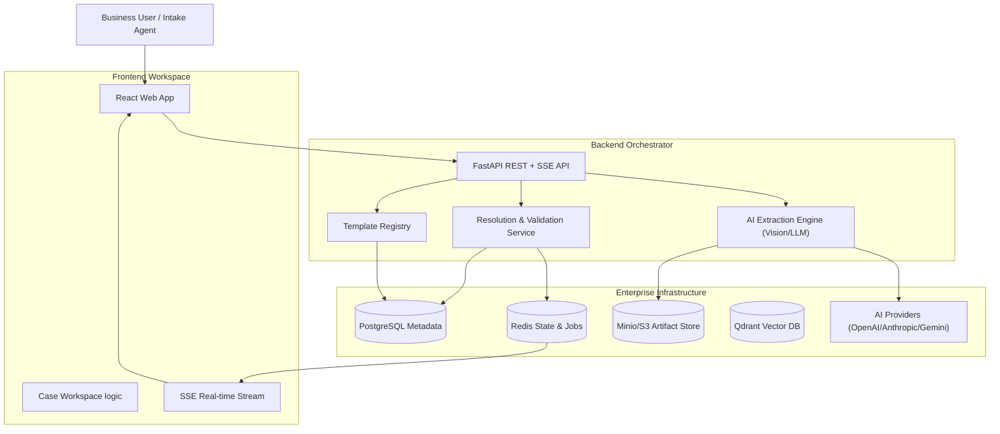

# FormFoundry Executive Brief

## 1. What this platform is

**FormFoundry** is an enterprise-grade automated form-filling and artifact-generation platform. It leverages advanced AI to transform unstructured inputs—such as scanned documents, freeform notes, and conversational answers—into validated, structured data and professional output artifacts (e.g., fillable PDFs).

The platform combines a high-performance FastAPI orchestration layer, a premium React-based workspace, and production-ready infrastructure (PostgreSQL, Redis, Minio/S3) to automate complex administrative and intake workflows at scale.

## 2. Why it matters to business stakeholders

- **Accelerated Service Delivery:** Move from raw intake to final document generation in minutes instead of hours or days.
- **Unmatched Accuracy:** AI-driven extraction combined with deterministic resolution and validation eliminates manual data-entry errors.
- **Domain Agnostic Flexibility:** Rapidly deploy new form types and workflows using declarative JSON templates without requiring custom code.
- **Operational Transparency:** Full audit trails for every field, showing exactly which piece of evidence supported an AI-driven extraction.

## 3. Client-facing capabilities

| Capability                   | What the client gets                                         | How it works in practice                                                                   | Business impact                                                                |
| :--------------------------- | :----------------------------------------------------------- | :----------------------------------------------------------------------------------------- | :----------------------------------------------------------------------------- |
| **Intelligent Intake**       | Support for diverse input sources (PDF, Images, Notes, Chat) | Users upload evidence or type notes; the system rasterizes visual media for analysis       | Consolidates all data sources into a single, unified intake stream             |
| **Vision-AI Extraction**     | Automated data capture from complex, unstructured documents  | Vision-based OCR and LLMs (via LiteLLM) propose field candidates with evidence attribution | Drastically reduces manual transcription effort and data entry costs           |
| **Deterministic Resolution** | High-confidence automated resolution with conflict detection | The engine selects the best candidates based on confidence and rules, flagging ambiguities | Ensures high data integrity while highlighting only what needs human attention |
| **Interactive Assistant**    | Real-time chat for gathering missing or ambiguous data       | An AI assistant identifies gaps and streams clarifying questions directly to the user      | Shortens the data collection cycle by proactively resolving ambiguities        |
| **Rule-Based Validation**    | Automated checks for schema, logic, and cross-field rules    | Every case is validated against template rules to ensure completeness and accuracy         | Minimizes downstream errors and re-work costs by catching issues at the source |
| **Artifact Generation**      | One-click production of professional, ready-to-use documents | Validated data is injected into official templates (e.g., PDFs) for instant download       | Accelerates the final delivery of professional service artifacts               |
| **Domain Portability**       | A system that learns new forms via declarative templates     | Business analysts define form schemas in JSON to add new domains (FIR, Insurance, Medical) | Enables rapid scaling into new business lines with zero software development   |
| **Audit & Governance**       | Clear traceability of every field value back to its source   | The system persists "Resolution Audit" records for every decision made by AI or humans     | Supports regulatory compliance and improves transparency in decision-making    |

## 4. Security and governance posture

- **Data Sovereignty:** Designed for on-premise or private cloud deployment, keeping sensitive client data within your controlled infrastructure.
- **Evidence Isolation:** Logical workspace isolation at the case level with S3-prefix strategies for evidence and artifact storage.
- **Transparent Attribution:** Every AI-proposed value is linked to a specific text chunk or document page, providing a clear "why" for every decision.
- **Secure Persistence:** Uses PostgreSQL for durable relational metadata and Minio (S3) for secure object storage.

## 5. Technology and architecture at a glance

### Core Stack

- **Frontend:** React 18, TypeScript, Vite, shadcn/ui, Tailwind CSS
- **Backend:** FastAPI, Python 3.12, SQLAlchemy, LiteLLM (LLM Orchestration)
- **Infrastructure:** PostgreSQL (Metadata), Redis (Jobs/State), Minio (S3 Storage), Qdrant (Vector DB)

### High-Level Architecture Diagram

### Operational Model

1. **Intake**: User submits documents, photos, or text notes to a new case.
2. **Extraction**: The backend triggers asynchronous Vision-AI jobs to identify data points.
3. **Refinement**: The resolution engine proposes values; the interactive assistant asks follow-up questions for any missing fields.
4. **Validation**: All data is checked against schema and business rules.
5. **Finalization**: An authorized agent approves the case, and the system generates the final PDF artifacts.

## 6. Deployment Readiness

FormFoundry supports three flexible deployment profiles:

- **Local/Developer:** Optimized for rapid iteration and testing.
- **Staging/Staged:** Fully containerized via Docker Compose for QA and client previews.
- **Enterprise/Cloud:** Scalable, stateless backend nodes with managed persistence and high-availability object storage.

## 7. API and Integration Footprint

The platform exposes a modern REST + SSE API for seamless integration with existing enterprise systems:

- **Template Management**: Programmatic creation and versioning of form types.
- **Case Lifecycle**: Full control over case creation, ingestion, and progression.
- **Data Export**: Retrieve validated structured data for downstream ERP/CRM systems.
- **Artifact Access**: Secure, authenticated retrieval of generated document files.

## 8. Engineering Maturity Indicators

- **Modular Design**: Feature-based organization for both frontend and backend to ensure maintainability.
- **Extensive Documentation**: Comprehensive technical wiki (MkDocs) and ADRs (Architectural Decision Records).
- **Quality Assurance**: Structured testing across unit, integration, and API layers.
- **Generalized Core**: A domain-agnostic engine that can be repurposed for any vertical without core changes.

## 9. Positioning Statement for Prospective Clients

**FormFoundry provides a secure, intelligent, and infinitely adaptable foundation for document automation—enabling organizations to transform chaotic unstructured intake into precise, validated actions while maintaining full governance and audit control.**
