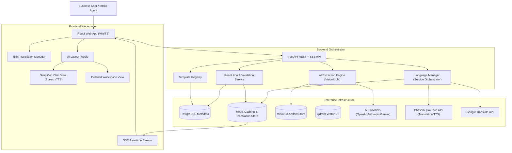

# FormFoundry Executive Brief

## 1. What this platform is

**FormFoundry** is an enterprise-grade automated form-filling, multilingual intake, and artifact-generation platform. It leverages advanced AI to transform unstructured inputs—such as scanned documents, freeform notes, and conversational answers in regional languages—into validated, structured data and professional output artifacts (e.g., fillable PDFs).

The platform combines a high-performance FastAPI orchestration layer, a pluggable multilingual & translation subsystem, a premium React-based workspace featuring a dual detailed/simplified chat-first UI, and production-ready infrastructure (PostgreSQL, Redis, Minio/S3) to automate complex administrative and intake workflows at scale.

## 2. Why it matters to business stakeholders

- **Accelerated Service Delivery:** Move from raw intake to final document generation in minutes instead of hours or days, regardless of the input language.
- **Democratized Access & Regional Outreach:** Support client-facing workflows in multiple regional languages (such as Hindi and English) using state-of-the-art translation and speech synthesis APIs.
- **Unmatched Accuracy:** AI-driven extraction combined with deterministic resolution, validation, and real-time translation eliminates manual data-entry and language transcription errors.
- **Dynamic No-Code Customization:** Empower non-technical administrators to design custom intake schemas, field groupings, and versioned forms entirely from the UI with zero code modifications, while the backend automatically builds matching interactive PDF assets on-the-fly.
- **Operational Transparency:** Full audit trails for every field, showing exactly which piece of evidence supported an AI-driven extraction, complete with translation provenance.

## 3. Client-facing capabilities

| Capability                    | What the client gets                                         | How it works in practice                                                                               | Business impact                                                                 |
| :---------------------------- | :----------------------------------------------------------- | :----------------------------------------------------------------------------------------------------- | :------------------------------------------------------------------------------ |
| **Intelligent Intake**        | Support for diverse input sources (PDF, Images, Notes, Chat) | Users upload evidence or type notes; the system rasterizes visual media for analysis                   | Consolidates all data sources into a single, unified intake stream              |
| **Pluggable Multilingualism** | Real-time multilingual processing and translation sync       | Dynamically detects user input languages, translates content, and syncs user preferences               | Breaks down language barriers in public services, GovTech, and global markets   |
| **Speech Accessibility**      | Playback of assistant questions via Text-to-Speech (TTS)     | Users can click to hear the assistant's questions spoken aloud in their active language                | Dramatically improves accessibility for low-literacy and mobile-first users     |
| **Vision-AI Extraction**      | Automated data capture from complex, unstructured documents  | Vision-based OCR and LLMs (via LiteLLM) propose field candidates with evidence attribution             | Drastically reduces manual transcription effort and data entry costs            |
| **Deterministic Resolution**  | High-confidence automated resolution with conflict detection | The engine selects the best candidates based on confidence and rules, flagging ambiguities             | Ensures high data integrity while highlighting only what needs human attention  |
| **Rule-Based Validation**     | Automated checks for schema, logic, and cross-field rules    | Every case is validated against template rules to ensure completeness and accuracy                     | Minimizes downstream errors and re-work costs by catching issues at the source  |
| **Artifact Generation**       | One-click production of professional, ready-to-use documents | Validated data is injected into official templates (e.g., PDFs) for instant download                   | Elevates professional services and speeds up final document delivery            |
| **No-Code Templating**        | Dynamic intake schema design and versioned form builder      | Non-technical administrators define intake fields and groups in the UI; PDF sheets generate on-the-fly | Dramatically reduces deployment time for new intake types from weeks to minutes |
| **Audit & Governance**        | Clear traceability of every field value back to its source   | The system persists "Resolution Audit" records for every decision made by AI or humans                 | Supports regulatory compliance and improves transparency in decision-making     |

## 4. Security and governance posture

- **Data Sovereignty:** Designed for on-premise or private cloud deployment, keeping sensitive client data within your controlled infrastructure.
- **Evidence Isolation:** Logical workspace isolation at the case level with S3-prefix strategies for evidence and artifact storage.
- **Transparent Attribution & Provenance:** Every AI-proposed value is linked to a specific text chunk or document page, preserving original non-English inputs alongside English translations.
- **Secure Persistence & Cache:** Uses PostgreSQL for relational metadata, Minio (S3) for secure object storage, and password-authenticated Redis for secure translation caching.

## 5. Technology and architecture at a glance

### Core Stack

- **Frontend:** React 18, TypeScript, Vite, shadcn/ui, Tailwind CSS, `react-i18next` (Internationalization)
- **Backend:** FastAPI, Python 3.12, SQLAlchemy, LiteLLM (LLM Orchestration), `langdetect`, Pluggable Translation & TTS Interfaces
- **Infrastructure:** PostgreSQL (Metadata), Redis (Jobs/State/Translation Caching), Minio (S3 Storage), Qdrant (Vector DB)
- **Ext. Services:** Google Translate API, Bhashini AI Pipeline API (National GovTech Translation Service)

### High-Level Architecture Diagram

### Operational Model

1. **Intake**: User submits documents, photos, or text notes to a new case, selecting their preferred language (English or Hindi).
2. **Translation & Detection**: The backend `LanguageManager` dynamically detects non-English inputs, translates them into English for processing, and caches translations in Redis.
3. **Extraction**: The backend triggers asynchronous Vision-AI jobs to identify data points on the English-translated text.
4. **Refinement**: The resolution engine proposes values. The assistant streams the next missing question, dynamically translated back into the user's active language, with clickable text-to-speech audio support.
5. **Validation**: All data is checked against schema and business rules.
6. **Finalization**: An authorized agent approves the case, and the system generates the final PDF artifacts.

## 6. Deployment Readiness

FormFoundry supports three flexible deployment profiles:

- **Local/Developer:** Optimized for rapid iteration, utilizing `langdetect` local fallback.
- **Staging/Staged:** Fully containerized via Docker Compose for QA and client previews with Redis translation caching.
- **Enterprise/Cloud:** Scalable, stateless backend nodes with highly available managed persistence, Bhashini regional AI pipeline endpoints, or Google cloud translation integrations.

## 7. API and Integration Footprint

The platform exposes a modern REST + SSE API for seamless integration with existing enterprise systems:

- **Language Controls**: Programmatically fetch translation configuration, detect language, synthesize text-to-speech audio, and sync preferred client locales.
- **Template Management**: Programmatic creation and versioning of form types.
- **Case Lifecycle**: Full control over case creation, ingestion, and progression.
- **Data Export**: Retrieve validated structured data for downstream ERP/CRM systems.
- **Artifact Access**: Secure, authenticated retrieval of generated document files.

## 8. Engineering Maturity Indicators

- **Modular Design**: Large pages and services are split into focused, single-responsibility components (e.g. `DetailedWorkspaceView`, `SimplifiedChatView`, `LanguageSelector`).
- **Pluggable Architecture**: Clear abstract base classes (ABCs) isolate external services (translation, text-to-speech) from core orchestration logic.
- **High-Performance Caching**: Redis-backed translation caching with SHA-256 keys eliminates duplicate API requests and reduces communication latency.
- **Extensive Documentation**: Comprehensive technical wiki (MkDocs) and ADRs (Architectural Decision Records).
- **Quality Assurance**: Structured testing across unit, integration, and language API layers.
- **Generalized Core**: A domain-agnostic engine that can be repurposed for any vertical without core changes.
- **Zero-Configuration PDF Generation**: The platform dynamically builds PDF templates on-the-fly when templates are created or updated, parsing complex coordinate and dot-notation data maps automatically.

## 9. Positioning Statement for Prospective Clients

**FormFoundry provides a secure, highly accessible, and infinitely adaptable foundation for document automation—enabling organizations to transform chaotic, regional, and multilingual unstructured intake into precise, validated actions while maintaining full governance and audit control.**
