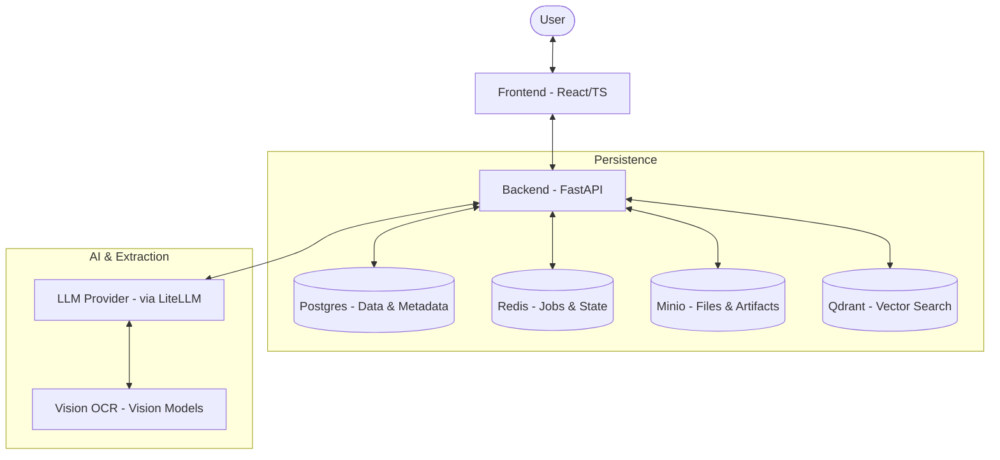
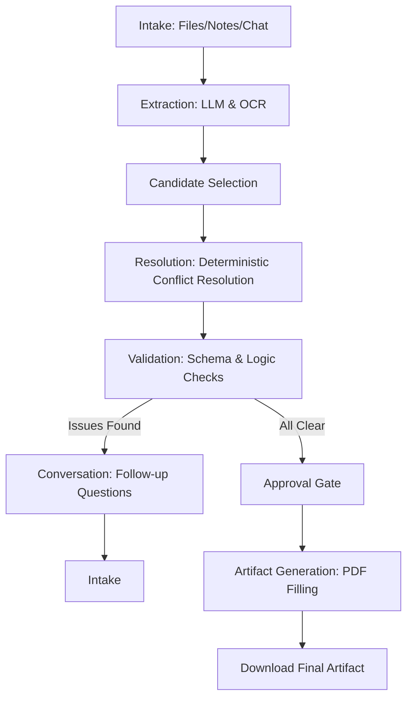

# FormFoundry

FormFoundry is a generalized form-filling and artifact-generation platform. It turns uploaded documents, freeform notes, and conversational answers into a validated case schema and exportable artifacts like filled PDFs.

## Architecture Overview

FormFoundry follows a modern full-stack architecture with a FastAPI backend and a React frontend, supported by a robust set of infrastructure services for data persistence, caching, and object storage.



## Key Features

- **Declarative Template Registry**: Version-aware template definitions loaded from JSON, allowing for easy expansion to new form types.
- **Multi-Source Intake**: Ingests data from uploaded files (PDFs, images), text notes, and interactive conversational turns.
- **AI-Powered Extraction**: Uses vision-based OCR and LLM orchestration via `litellm` to extract candidate data with evidence attribution.
- **Deterministic Resolution**: Resolves extracted candidates into field states with conflict detection and audit trails.
- **Interactive Conversation turn**: Streams follow-up questions via SSE based on unresolved fields and template priority.
- **Validation & Review**: Comprehensive validation engine for field-level and cross-field rules with a blocking approval gate.
- **Artifact Generation**: Renders approved case data into final artifacts, such as fillable PDFs.

## Tech Stack

| Component              | Technology                                                    |
| :--------------------- | :------------------------------------------------------------ |
| **Backend**            | FastAPI, Python 3.12+, SQLAlchemy, Alembic, Pydantic, LiteLLM |
| **Frontend**           | React 18, TypeScript, Vite, shadcn/ui, Tailwind CSS           |
| **Database**           | PostgreSQL 16                                                 |
| **Caching/Jobs**       | Redis                                                         |
| **Object Storage**     | Minio (S3 Compatible)                                         |
| **Vector DB**          | Qdrant                                                        |
| **Package Management** | `uv` (Backend), `pnpm` (Frontend)                             |
| **Orchestration**      | Docker Compose, Makefile                                      |

## Project Structure

```text
.
├── Makefile                # Lifecycle and management commands
├── docker-compose.yml      # Infrastructure orchestration
├── backend/                # Python source code
│   ├── app/                # Core application logic
│   │   ├── api/            # API endpoints and routing
│   │   ├── core/           # Configuration, logging, and security
│   │   ├── extraction/     # AI extraction and OCR logic
│   │   ├── templates/      # Template registry and seeding
│   │   └── ...             # Feature-specific modules (cases, intake, etc.)
│   ├── alembic/            # Database migrations
│   ├── assets/             # Demo PDFs and static files
│   └── pyproject.toml      # Backend dependencies and configuration
├── frontend/               # TypeScript source code
│   ├── src/                # React components and hooks
│   │   ├── components/     # UI components (shadcn/ui)
│   │   ├── pages/          # Main application views
│   │   └── ...
│   └── package.json        # Frontend dependencies and scripts
├── plans/                  # Product and implementation roadmaps
└── wikis/                  # Detailed project documentation
```

## Logic Flows

The following diagram illustrates the lifecycle of a case from initial intake to final artifact generation.



## Installation & Setup

### Prerequisites

- Docker and Docker Compose
- Python 3.12+ and `uv`
- Node.js and `pnpm`

### Local Development Setup

1. **Clone and Configure**:

   ```bash
   cp .env.example .env
   # Edit .env with your LLM keys (LLM_API_KEY, etc.)
   ```

2. **Infrastructure**:

   ```bash
   make up
   ```

3. **Backend Setup**:

   ```bash
   make backend-setup
   make backend-start
   ```

4. **Frontend Setup**:

   ```bash
   make frontend-setup
   make frontend-start
   ```

## Usage Examples

### Creating a Case

A case is initialized by selecting a template. For example, to start an Indian FIR Report:

1. Navigate to the "Intake Control Center".
2. Select the "FIR Report" template.
3. Upload evidence files or start typing notes.

### Interactive Extraction

Once evidence is uploaded, the system automatically triggers extraction jobs. You can monitor the "Extraction Dashboard" to see candidates being proposed by the LLM and attributed to specific parts of your evidence.

### Finalizing Artifacts

After all fields are resolved and validated, the "Approve" button becomes active. Clicking it generates the final PDF artifact, which can then be downloaded from the "Artifacts" tab.
