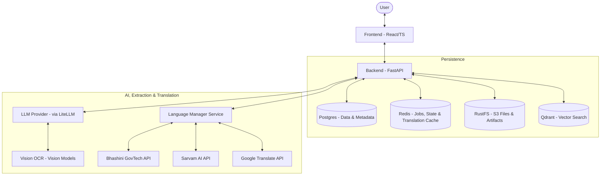
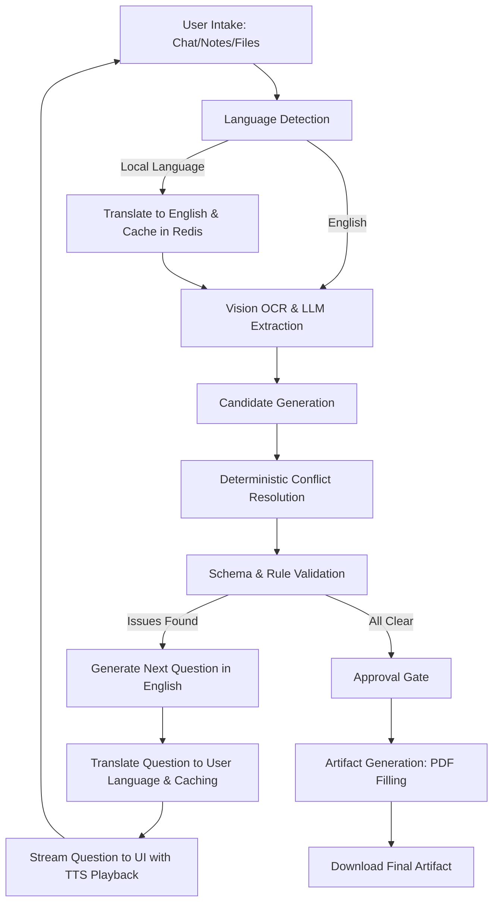

# FormFoundry

FormFoundry is an enterprise-grade, generalized, and multilingual form-filling and artifact-generation platform. It turns uploaded documents, freeform notes, and conversational answers in regional languages into a validated case schema and exportable artifacts like filled PDFs.

## Architecture Overview

FormFoundry follows a modern full-stack architecture with a FastAPI backend and a React frontend, supported by a robust set of infrastructure services for data persistence, caching, and object storage. The system incorporates a pluggable multilingual & speech engine that interfaces with standard and localized translation services.



## Key Features

- **Multilingual support**: `indic-language-utils` supplies Google translation, local FastText language detection, and Microsoft Edge TTS by default. Provider routes, model IDs, and voices are configured in `.indic-language-utils.toml`.
- **Dual-Workspace UX**: Seamless frontend view toggle between:
  - **Simplified Chat View**: A guided, chat-first UI featuring speech accessibility, strategists' reasoning insights, and quick inline field reviews.
  - **Detailed Workspace View**: A professional three-panel grid for concurrently analyzing uploaded evidence, reviewing structured field values, and auditing AI attribution.
- **High-Performance Translation Caching**: Redis-backed translation cache using collision-free SHA-256 hashed keys, reducing API costs and latency to near-zero.
- **Dynamic No-Code Template & Schema Builder**: Design, deploy, and version complex form intake templates directly from the React UI without writing backend code. Built-in layout groups, validation constraints, and computed dependencies hydrate the client-side form immediately.
- **ReportLab Platypus Dynamic PDF Compiler**: Decentralized from static PDF templates, approved cases are dynamically compiled on-the-fly into clean, elegant PDF reports featuring alternating row styling, organized group sections, and shaded card wells for long textual fields and repeated arrays.
- **Robust Template Engine Features**: Native backend support for dynamic regex checks, primitive list validation and coercion, multi-select enums, recursive logical conditional logic, and AST-parsed mathematical/string computation evaluations that automatically trigger during field resolution.
- **AI-Powered Extraction**: Uses vision-based OCR and LLM orchestration via `litellm` to extract candidate data with evidence attribution.
- **Deterministic Conflict Resolution**: Resolves extracted candidates into field states with conflict detection and audit trails.
- **Interactive Conversation turns**: Streams follow-up questions via SSE based on unresolved fields and template priority, automatically translated to the user's preferred language.

## Tech Stack

| Component              | Technology                                                                  |
| :--------------------- | :-------------------------------------------------------------------------- |
| **Backend**            | FastAPI, Python 3.12, SQLAlchemy, Alembic, Pydantic, LiteLLM, ReportLab, `indic-language-utils` |
| **Frontend**           | React 18, TypeScript, Vite, shadcn/ui, Tailwind CSS, `react-i18next`        |
| **Database**           | PostgreSQL 16                                                               |
| **Caching/Jobs**       | Redis 7 (State, Jobs, and Translation caching)                              |
| **Object Storage**     | RustFS (S3 Compatible)                                                      |
| **Vector DB**          | Qdrant                                                                      |
| **Package Management** | `uv` (Backend), `pnpm` (Frontend)                                           |
| **Orchestration**      | Docker Compose, Makefile                                                    |

## Project Structure

```text
.
├── Makefile                # Lifecycle and management commands
├── docker-compose.yml      # Infrastructure orchestration
├── backend/                # Python source code
│   ├── app/                # Core application logic
│   │   ├── api/            # API endpoints and routing (cases, languages, etc.)
│   │   ├── core/           # Configuration, logging, and security
│   │   ├── extraction/     # AI extraction and OCR logic
│   │   ├── languages/      # Pluggable Translation, TTS, and Caching engine
│   │   ├── templates/      # Template registry and seeding
│   │   └── ...             # Feature-specific modules (cases, intake, etc.)
│   ├── alembic/            # Database migrations
│   ├── assets/             # Demo PDFs and static files
│   └── pyproject.toml      # Backend dependencies and configuration
├── frontend/               # TypeScript source code
│   ├── src/                # React components and hooks
│   │   ├── components/     # UI Component library (shadcn/ui)
│   │   │   ├── case/       # Case workspace (Detailed, Simplified, LanguageSelector, FieldRow)
│   │   │   └── ui/         # Base atoms
│   │   ├── locales/        # Translation maps (en.json, hi.json)
│   │   ├── pages/          # Top-level page views (CaseWorkspace, TemplateSelection)
│   │   ├── i18n.ts         # i18next initialization and hooks
│   │   └── ...
│   └── package.json        # Frontend dependencies and scripts
├── plans/                  # Product and implementation roadmaps
└── docs/                   # Detailed project documentation (MkDocs Wiki)
```

## Logic Flows

The following diagram illustrates the lifecycle of a case, highlighting how bidirectional translation and layout toggles are woven into the standard intake loop.



## Installation & Setup

### Prerequisites

- Docker and Docker Compose
- Python 3.12 and `uv`
- Node.js and `pnpm`

### Local Development Setup

1. **Clone and Configure**:

   ```bash
   cp .env.example .env
   # Edit .env with your LLM keys and Language service providers
   ```

2. **Language provider configuration**:
   Translation, language detection, and speech use `indic-language-utils`. The root
   `.indic-language-utils.toml` selects the defaults:

   ```toml
   [routes]
   translation = ["googletrans"]
   text_language_detection = ["fasttext"]
   text_to_speech = ["edge_tts"]
   speech_to_text = []
   ```

   These defaults need no API keys. Google Translate and Microsoft Edge TTS are
   unofficial network adapters. FastText runs locally and downloads its model on
   first detection. Backend setup installs the required extras and uses Python 3.12.

   Set a route to `[]` to disable it. A comma-separated `ILU_ROUTE_TRANSLATION`,
   `ILU_ROUTE_TEXT_LANGUAGE_DETECTION`, `ILU_ROUTE_TEXT_TO_SPEECH`, or
   `ILU_ROUTE_SPEECH_TO_TEXT` environment variable overrides its TOML route.
   An explicitly empty override disables the capability. The old
   `LANGUAGE_DETECTION_SERVICE_PROVIDER`, `LANGUAGE_TRANSLATION_SERVICE_PROVIDER`,
   `TTS_SERVICE_PROVIDER`, and `STT_SERVICE_PROVIDER` variables are no longer used.

   For Bhashini or Sarvam, change the routes to `bhashini` or `sarvam`, configure
   endpoints and model/service IDs in the TOML provider sections, and supply
   `BHASHINI_API_KEY` or `SARVAM_API_KEY` in the root `.env`. See the commented
   provider and Edge voice examples in the TOML. Process environment values take
   precedence over `.env`. `ILU_CONFIG_FILE` selects an alternative TOML file.

3. **Infrastructure**:

   ```bash
   make up
   ```

4. **Backend Setup**:

   ```bash
   make backend-setup
   ```

5. **Frontend Setup**:

   ```bash
   make frontend-setup
   ```

Templates created in the builder are stored only in the database. To import the
bundled examples into a new database, run `uv run python seed_templates.py` from
`backend/`. This adds missing template versions without replacing existing ones.
App startup does not synchronize templates with JSON files.

## Running the Application

- **Start All**: `make start`
- **Stop All**: `make stop`

## Usage Examples

### Case Localization

1. Launch the intake page and look at the **Language Selector** dropdown (globe icon) in the header.
2. Select **हिन्दी** (Hindi) to instantly switch the interface locale.
3. The assistant will translate and stream all subsequent follow-up questions into Hindi.
4. Click the speaker icon next to any assistant response to hear the question played back via **Text-to-Speech (TTS)**.

### Toggling Workspace Layouts

- Click **Chat** in the header toggle to use the streamlined, mobile-friendly conversational intake view.
- Click **Detailed** to open the side-by-side evidence inspection panel, candidate resolution tables, and validation errors.

### Dynamic No-Code Template Creation & Intake Filling

1. Click **Create Group Selection** / **Create Template** in the navigation header to open the schema designer.
2. Define your schema fields (e.g. complainant name, type, required status, default questions) and custom group categories.
3. Click **Publish** to instantly register the template in the database.
4. Once published, the template is fully registered and case workflows can be instantly launched for it.
5. Create a new case under your custom template, fill the fields (conversationally or manually), approve the case, and download your beautifully styled, dynamically-compiled custom PDF report complete with your data laid out in neat, grouped tables and cards!
