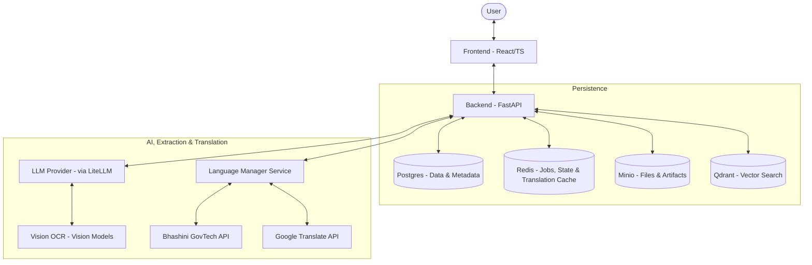
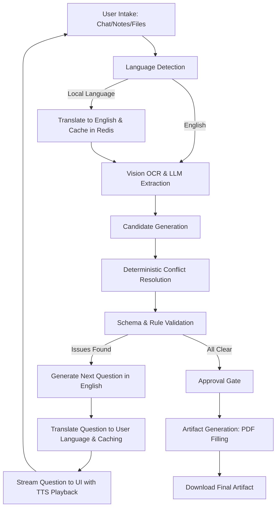

# FormFoundry

FormFoundry is an enterprise-grade, generalized, and multilingual form-filling and artifact-generation platform. It turns uploaded documents, freeform notes, and conversational answers in regional languages into a validated case schema and exportable artifacts like filled PDFs.

## Architecture Overview

FormFoundry follows a modern full-stack architecture with a FastAPI backend and a React frontend, supported by a robust set of infrastructure services for data persistence, caching, and object storage. The system incorporates a pluggable multilingual & speech engine that interfaces with standard and localized translation services.



## Key Features

- **Pluggable Multilingual Orchestrator**: High-fidelity real-time language detection, translation, and text-to-speech (TTS) synthesis supporting **Google Translate** and **Bhashini** (the Indian national language portal for GovTech), with local `langdetect` fallback capability.
- **Dual-Workspace UX**: Seamless frontend view toggle between:
  - **Simplified Chat View**: A guided, chat-first UI featuring speech accessibility, strategists' reasoning insights, and quick inline field reviews.
  - **Detailed Workspace View**: A professional three-panel grid for concurrently analyzing uploaded evidence, reviewing structured field values, and auditing AI attribution.
- **High-Performance Translation Caching**: Redis-backed translation cache using collision-free SHA-256 hashed keys, reducing API costs and latency to near-zero.
- **Declarative Template Registry**: Version-aware template definitions loaded from JSON, allowing for easy expansion to new form types (e.g. Indian FIR reports, Medical screening, Insurance).
- **AI-Powered Extraction**: Uses vision-based OCR and LLM orchestration via `litellm` to extract candidate data with evidence attribution.
- **Deterministic Conflict Resolution**: Resolves extracted candidates into field states with conflict detection and audit trails.
- **Interactive Conversation turns**: Streams follow-up questions via SSE based on unresolved fields and template priority, automatically translated to the user's preferred language.

## Tech Stack

| Component              | Technology                                                                  |
| :--------------------- | :-------------------------------------------------------------------------- |
| **Backend**            | FastAPI, Python 3.12+, SQLAlchemy, Alembic, Pydantic, LiteLLM, `langdetect` |
| **Frontend**           | React 18, TypeScript, Vite, shadcn/ui, Tailwind CSS, `react-i18next`        |
| **Database**           | PostgreSQL 16                                                               |
| **Caching/Jobs**       | Redis 7 (State, Jobs, and Translation caching)                              |
| **Object Storage**     | Minio (S3 Compatible)                                                       |
| **Vector DB**          | Qdrant                                                                      |
| **Package Management** | `uv` (Backend), `pnpm` (Frontend)                                           |
| **Orchestration**      | Docker Compose, Makefile                                                    |

## Project Structure

```text
.
├── Makefile                # Lifecycle and management commands
├── docker-compose.yml      # Infrastructure orchestration
├── backend/                # Python source code
│   ├── app/                # Core application logic
│   │   ├── api/            # API endpoints and routing (cases, languages, etc.)
│   │   ├── core/           # Configuration, logging, and security
│   │   ├── extraction/     # AI extraction and OCR logic
│   │   ├── languages/      # Pluggable Translation, TTS, and Caching engine
│   │   ├── templates/      # Template registry and seeding
│   │   └── ...             # Feature-specific modules (cases, intake, etc.)
│   ├── alembic/            # Database migrations
│   ├── assets/             # Demo PDFs and static files
│   └── pyproject.toml      # Backend dependencies and configuration
├── frontend/               # TypeScript source code
│   ├── src/                # React components and hooks
│   │   ├── components/     # UI Component library (shadcn/ui)
│   │   │   ├── case/       # Case workspace (Detailed, Simplified, LanguageSelector, FieldRow)
│   │   │   └── ui/         # Base atoms
│   │   ├── locales/        # Translation maps (en.json, hi.json)
│   │   ├── pages/          # Top-level page views (CaseWorkspace, TemplateSelection)
│   │   ├── i18n.ts         # i18next initialization and hooks
│   │   └── ...
│   └── package.json        # Frontend dependencies and scripts
├── plans/                  # Product and implementation roadmaps
└── docs/                   # Detailed project documentation (MkDocs Wiki)
```

## Logic Flows

The following diagram illustrates the lifecycle of a case, highlighting how bidirectional translation and layout toggles are woven into the standard intake loop.



## Installation & Setup

### Prerequisites

- Docker and Docker Compose
- Python 3.12+ and `uv`
- Node.js and `pnpm`

### Local Development Setup

1. **Clone and Configure**:

   ```bash
   cp .env.example .env
   # Edit .env with your LLM keys and Language service providers
   ```

2. **Language Service Provider Configuration**:
   Open `.env` and configure the following parameters to enable translations:

   ```bash
   # Enable Language Providers (e.g. google, bhashini, langdetect, or None)
   LANGUAGE_DETECTION_SERVICE_PROVIDER=langdetect
   LANGUAGE_TRANSLATION_SERVICE_PROVIDER=google  # or bhashini
   TTS_SERVICE_PROVIDER=bhashini                 # Enables text-to-speech
   STT_SERVICE_PROVIDER=None

   # Bhashini GovTech API Credentials
   BHASHINI_API_KEY=your-bhashini-api-key
   BHASHINI_ENDPOINT_URL=https://dhruva-api.bhashini.gov.in/services/inference/pipeline
   BHASHINI_TRANSLATION_SERVICE_ID=ai4bharat/indictrans-v2-all-gpu--t4
   ```

3. **Infrastructure**:

   ```bash
   make up
   ```

4. **Backend Setup**:

   ```bash
   make backend-setup
   ```

5. **Frontend Setup**:

   ```bash
   make frontend-setup
   ```

## Running the Application

- **Start All**: `make start`
- **Stop All**: `make stop`

## Usage Examples

### Case Localization

1. Launch the intake page and look at the **Language Selector** dropdown (globe icon) in the header.
2. Select **हिन्दी** (Hindi) to instantly switch the interface locale.
3. The assistant will translate and stream all subsequent follow-up questions into Hindi.
4. Click the speaker icon next to any assistant response to hear the question played back via **Text-to-Speech (TTS)**.

### Toggling Workspace Layouts

- Click **Chat** in the header toggle to use the streamlined, mobile-friendly conversational intake view.
- Click **Detailed** to open the side-by-side evidence inspection panel, candidate resolution tables, and validation errors.
