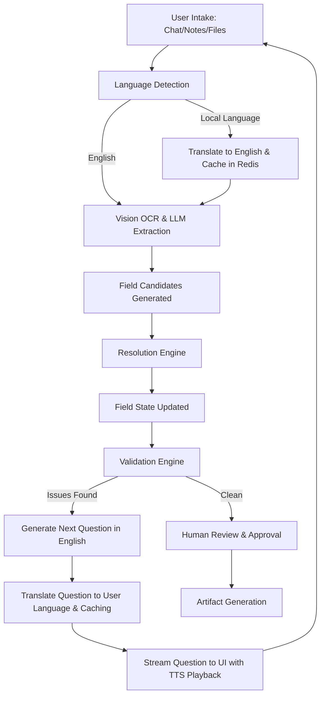

# Data Flow

This document details the lifecycle of data within FormFoundry, from initial intake and language detection to dynamic translation, resolution, validation, and final artifact generation.

## The Case Lifecycle

FormFoundry processes data through a series of well-defined stages, augmenting standard intake with translation pipelines when non-English inputs are detected:

---

## 1. Intake, Language Detection & Syncing

Data enters the system via three channels:

- **File Uploads**: PDFs and images are uploaded to Minio.
- **Notes**: Freeform text is saved directly to the database as evidence.
- **Chat**: User answers are ingested as conversational turns.

### Language Detection & Pref Sync

When a user submits a conversational turn:

1. If the locale in `payload.language` is provided, that language is used.
2. If not, the backend `LanguageManager` runs language detection (via Google, Bhashini, or `langdetect`) on the raw message.
3. If a change in language is detected (e.g. user replies in Hindi), the case's relational metadata is updated to store this `preferred_language`.
4. This synchronizes the frontend and backend preferred language, persisting it across page refreshes.

---

## 2. Ingest Translation & Caching

If the incoming evidence or chat answer is in a regional language (e.g. Hindi), it is translated into English before going to the extraction engine:

1. **Cache Lookup**: The `LanguageManager` hashes the text with SHA-256 and searches the Redis translation cache (`translation:hi:en:<hash>`).
2. **Translation Service**: On a cache miss, the active translation provider (Google or Bhashini) translates the text to English.
3. **Cache Storage**: The resulting English translation is stored in Redis with a 24-hour TTL.
4. **Attribution**: The English translation is stored in the database under `english_translation` in the turn metadata, while the raw Hindi is preserved for user review.

---

## 3. Extraction & Candidates

The extraction engine processes evidence asynchronously on the English version of the text:

- **OCR**: Raw text is extracted from visual media.
- **LLM Proposals**: The LLM analyzes the text against the case template schema and proposes **Field Candidates**.
- **Attribution**: Each candidate is linked to the evidence record and the specific text chunk (with its original and translated views) that generated it.

---

## 4. Resolution & Validation

The resolution engine updates the **Field State** based on candidates:

- **Deterministic Logic**: High-confidence candidates without conflicts are resolved automatically.
- **Conflict Detection**: Multiple conflicting candidates leave fields "unresolved" and flag them.
- **Manual Overrides**: Users can manually confirm or edit field values, overriding AI candidates.
- **Validation**: Schema checks (requiredness, regex patterns) and cross-field logic are run. Discovered problems are saved as **Validation Issues**.

---

## 5. Conversational Follow-up, Outgoing Translation & TTS

If there are unresolved fields or validation issues, the assistant generates a follow-up question:

1. **Question Generation**: The `app/conversation/service.py` deterministically selects the outstanding field candidates, then requires the LLM to generate the consolidated, English follow-up question text. The backend does not fall back to canned template questions.
2. **Read-only Preview**: `GET /conversation/next-question` computes the current question without inserting a conversation turn. This keeps polling and page reloads idempotent.
3. **Canonical Timeline**: Assistant questions are persisted only during command flows: case creation, submitted user answers, evidence ingestion, and field rejection. `GET /conversation/turns` is the canonical chronological timeline rendered by the frontend.
4. **Outgoing Translation**: If the case's `preferred_language` is not English (e.g. Hindi), the persisted assistant question is translated back to the target language (utilizing the Redis cache `translation:en:hi:<hash>` to avoid redundant translations).
5. **Text-to-Speech (TTS)**: When the user views the question on the frontend (Simplified or Detailed), they can trigger real-time Text-to-Speech audio playback. The backend `/languages/tts` route handles generating MP3 audio bytes using Bhashini's speech pipelines, streaming the audio directly back to the React player.

---

## 6. Artifact Generation

Once all fields are confirmed, verified, and approved:

- **Rendering**: The case data is injected into official document templates (e.g., fillable PDFs).
- **Persistence**: The final document is stored in Minio.
- **Metadata**: Artifact metadata is saved for instant client download.
