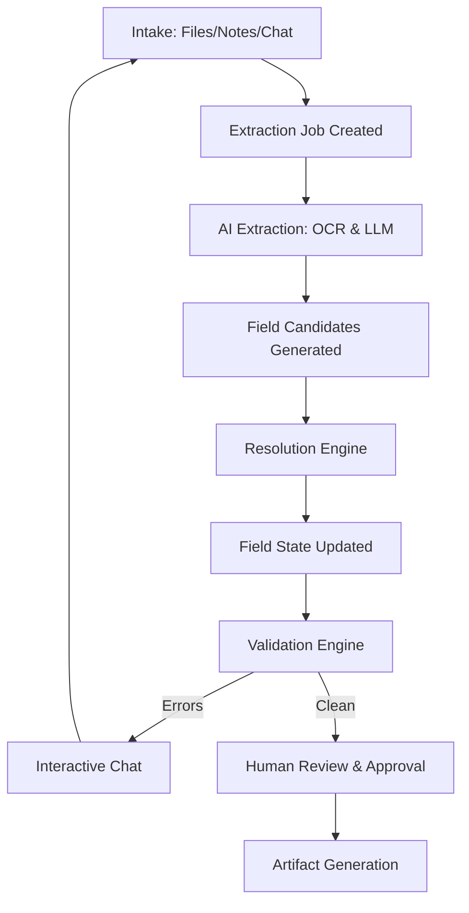

# Data Flow

This document details the lifecycle of data within FormFoundry, from initial intake to final artifact generation.

## The Case Lifecycle

FormFoundry processes data through a series of well-defined stages:

## 1. Intake & Ingestion

Data enters the system via three channels:

- **File Uploads**: PDFs and images are stored in Minio.
- **Notes**: Freeform text is saved directly to the database as evidence.
- **Chat**: User answers are ingested as a special type of evidence.

Every piece of intake creates an **Evidence Record** and triggers an **Extraction Job**.

## 2. Extraction & Candidates

The extraction engine processes evidence asynchronously:

- **OCR**: Raw text is extracted from visual media.
- **LLM Proposals**: The LLM analyzes the text against the case template and proposes **Field Candidates**.
- **Attribution**: Each candidate is linked to the evidence record and specific text chunk that generated it.

## 3. Resolution

The resolution engine updates the **Field State** based on candidates:

- **Deterministic Logic**: If a high-confidence candidate exists without conflicts, the field is resolved automatically.
- **Conflict Detection**: If multiple conflicting candidates exist, the field remains "unresolved" and flagged for review.
- **Manual Overrides**: Users can manually set field values, which takes precedence over AI candidates.

## 4. Validation

The validation engine runs after every resolution cycle:

- **Schema Validation**: Checks for requiredness, data types, and enum constraints.
- **Cross-Field Rules**: Executes complex logic that depends on multiple fields (e.g., "End Date must be after Start Date").
- **Issues**: Discovered problems are saved as **Validation Issues** and displayed in the UI.

## 5. Artifact Generation

Once a case is approved:

- **Rendering**: The case data is injected into a template (e.g., a fillable PDF).
- **Persistence**: The final document is stored in Minio.
- **Metadata**: Artifact metadata (renderer version, timestamp) is recorded.
