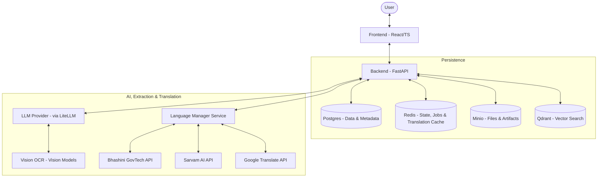

# Architecture Overview

FormFoundry is built using a modern decoupled architecture, separating a Python/FastAPI backend from a React/TypeScript frontend. The system is designed for scalability, extensibility, and global accessibility—particularly in how it dynamically supports declarative templates, vision-based extraction, and real-time multilingual translation and speech services.

## System Diagram

The following diagram illustrates the high-level relationship between the components:

## Core Components

### 1. Frontend (React/TypeScript)

The frontend is a Single Page Application (SPA) built with Vite and internationalized via `react-i18next`. It provides a rich, interactive environment with a **Dual-Workspace** layout, allowing users to toggle between:

- **Simplified Chat View**: A streamlined, speech-synthesized (TTS), conversational guided intake flow.
- **Detailed Workspace View**: A professional three-panel grid designed for in-depth data reviews and audit processes.

### 2. Backend (FastAPI)

The backend serves as the central orchestration layer. It manages case lifecycles, extraction jobs, validation, and dynamic artifact generation. It hosts a **Dynamic No-Code Template & Schema Builder** allowing administrators to create versioned intake templates entirely from the UI. When cases are completed and approved, the system dynamically compiles professional, well-formatted PDF reports using a ReportLab Platypus page layout compiler. Additionally, it features a pluggable **Language Manager** service that dynamically detects input languages, translates content bidirectionally between regional languages and English, synthesizes speech, and syncs user preferences.

### 3. Persistence & Caching Layer

- **Postgres**: Stores all relational data, including template definitions, case states, and resolution audits.
- **Redis**: Used for task queuing, transient state management, and **high-performance translation caching** using hashed SHA-256 keys to avoid redundant, costly external API requests.
- **Minio**: An S3-compatible object store used for preserving uploaded evidence and generated artifacts.
- **Qdrant**: A vector database provisioned for semantic search and retrieval-augmented generation (RAG) capabilities.

### 4. Extraction & Translation Engine

- **Extraction Service**: Leverages `litellm` to interface with various LLM providers, performs OCR, and extracts structured data from unstructured inputs.
- **Language Subsystem**: Orchestrates translation and speech synthesis using pluggable provider interfaces (Google, Bhashini, Sarvam, local fallbacks), allowing GovTech and enterprise products to adapt to local regional environments.

## Request Lifecycle

1. **Client Request**: The frontend sends an HTTP request or establishes an SSE stream.
2. **API Router**: The request is routed to the appropriate feature route.
3. **Language Detection & Translation**: If input contains non-English text, it is dynamically translated to English (relying on the Redis cache for quick hits) before passing it to LLM extraction engines.
4. **Dependency Injection**: Database sessions and service singletons (like `LanguageManager`) are injected.
5. **Service Layer**: Core business and resolution logic is executed.
6. **Outgoing Translation**: Follow-up questions generated in English are translated into the user's preferred language before being sent back.
7. **Response**: A localized JSON response or SSE stream event is returned to the client.
