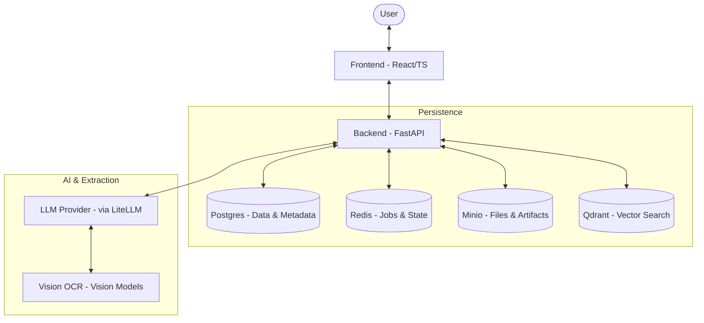

# Architecture Overview

FormFoundry is built using a modern decoupled architecture, separating a Python/FastAPI backend from a React/TypeScript frontend. The system is designed for scalability and extensibility, particularly in how it handles templates and extraction logic.

## System Diagram

The following diagram illustrates the high-level relationship between the components:

## Core Components

### 1. Frontend (React/TypeScript)

The frontend is a Single Page Application (SPA) built with Vite. It provides a rich, interactive environment for users to select templates, upload evidence, review extracted data, and engage in follow-up conversations.

### 2. Backend (FastAPI)

The backend serves as the central orchestration layer. It manages the template registry, case lifecycles, extraction jobs, and artifact generation. It provides a RESTful API and uses SSE (Server-Sent Events) for real-time updates.

### 3. Persistence Layer

- **Postgres**: Stores all relational data, including template definitions, case states, and resolution audits.
- **Redis**: Used for task queuing (via FastAPI background tasks) and transient state management.
- **Minio**: An S3-compatible object store used for preserving uploaded evidence and generated artifacts.
- **Qdrant**: A vector database provisioned for semantic search and retrieval-augmented generation (RAG) capabilities.

### 4. Extraction Engine

The extraction engine leverages `litellm` to interface with various LLM providers. It performs vision-based OCR on documents and uses structured prompts to extract field candidates from unstructured data.

## Request Lifecycle

1. **Client Request**: The frontend sends an HTTP request to the backend.
2. **API Router**: The request is routed to the appropriate endpoint.
3. **Dependency Injection**: Common dependencies like the database session are injected.
4. **Service Layer**: Business logic is executed within the service layer.
5. **Persistence**: Data is read from or written to the persistence layer.
6. **Response**: A JSON response or SSE stream is returned to the client.
