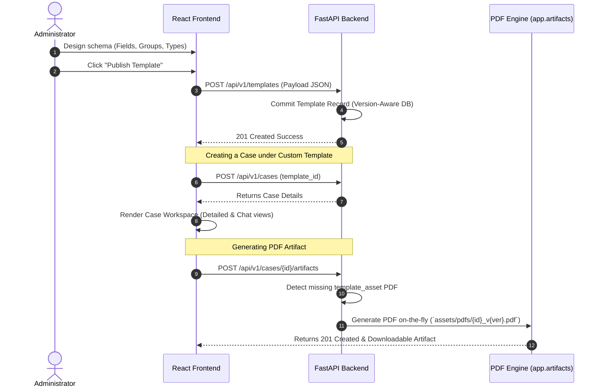

# No-Code Custom Template & Form Builder

The FormFoundry frontend hosts a premium, dynamic **No-Code Custom Template Builder** that empowers administrators to design and deploy versioned form schemas directly from the web application.

Once created, these custom templates dynamically hydrate the case workspace, automatically generating interactive form panels, real-time LLM-driven chat question guides, and programmatic fillable PDF assets on-the-fly.

---

## 1. Core Architecture & Views

The no-code workspace resides entirely within the frontend client and communicates with backend service layers using thin REST wrappers. It is divided into three key areas:

### A. Template Registry & Selection

- **Path**: `frontend/src/pages/TemplateSelection.tsx`
- **Role**: Displays all registered templates inside elegant, theme-aware, hover-animated cards.
- **Dynamic Sizing**: Features a smart card-height resolution toggle (`templateCases.length > 0 ? 'h-full' : 'h-fit'`) preventing empty white space layouts when a template has no active cases.

### B. Schema Designer Workspace

- **Path**: `frontend/src/components/case/TemplateCard.tsx` (Triggering Creation dialogs)
- **Role**: Allows creators to build fields dynamically. For each field, administrators can declaratively configure:
  - **Path & Dot Notation**: (e.g. `complainant.full_name` or `incident.date`).
  - **Label**: Visual indicator displayed to the intake agent.
  - **Value Type**: supports `string`, `number`, `boolean`, `date`, or `enum` options.
  - **Required Checkbox**: Toggles whether the field must be supplied before final approval.
  - **Default Question & Help Text**: Guided text utilized by the conversational LLM.

### C. Versioned Intake Generation

- **Path**: `frontend/src/components/case/TemplateCasesDialog.tsx`
- **Role**: Manages active case lists for templates, resolving React Hook lifecycle bugs by placing all hooks before early return boundaries.

---

## 2. Dynamic Frontend Hydration Flow

When a user creates a new case under a dynamically-built custom template, the frontend hydrates the workspace dynamically without hardcoding:

---

## 3. UI Component Breakdown

### 1. `TemplateSelection.tsx`

The primary landing workspace that displays active case summaries, handles deletion of empty or stale templates, and initiates new cases. It triggers full localized translations automatically.

### 2. `TemplateCasesDialog.tsx`

Allows agents to see all active cases tied to a given custom schema. To avoid hooks violation crashes:

- All `useState` and `useEffect` hooks are placed strictly at the top of the component.
- Conditional render triggers are evaluated only after hooks are fully initialized.

### 3. Dynamic Field Rows (`FieldRow.tsx`)

A generic component that adapts its input controls dynamically based on the field type registered in the schema:

- **`date`**: Renders calendar picker with robust support for textual entries.
- **`enum`**: Renders Shadcn dropdown selectors.
- **`boolean`**: Renders custom switches.
- **`string` / `number`**: Renders formatted text boxes.

---

## 4. Key Performance Optimizations

1. **On-the-Fly PDF Asset Generation**: Eliminates the overhead of preparing static forms in advance. If `template_asset` is missing, the backend immediately builds a clean form from the custom schema.
2. **Collision-Free Path Mapping**: Dot-notation paths are mapped to flat variable names (e.g., `complainant.full_name` is safely translated to `complainant_full_name` inside fillable forms), maintaining complete compatibility with third-party PDF form injection software.
3. **Flexible Text Normalization**: Prevents repeated extraction loops on textual dates or optional skip keywords, instantly synchronizing resolved values to `"NA"` to keep the conversation flowing smoothly.
